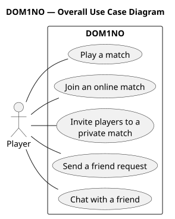
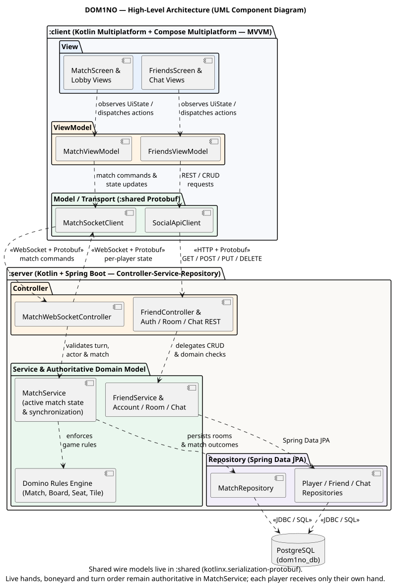
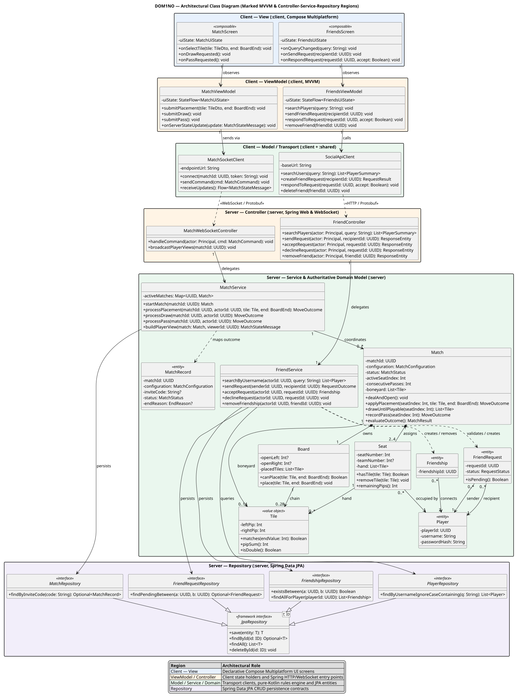
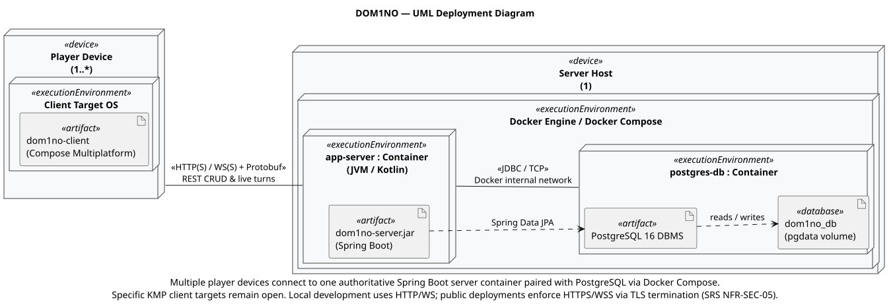
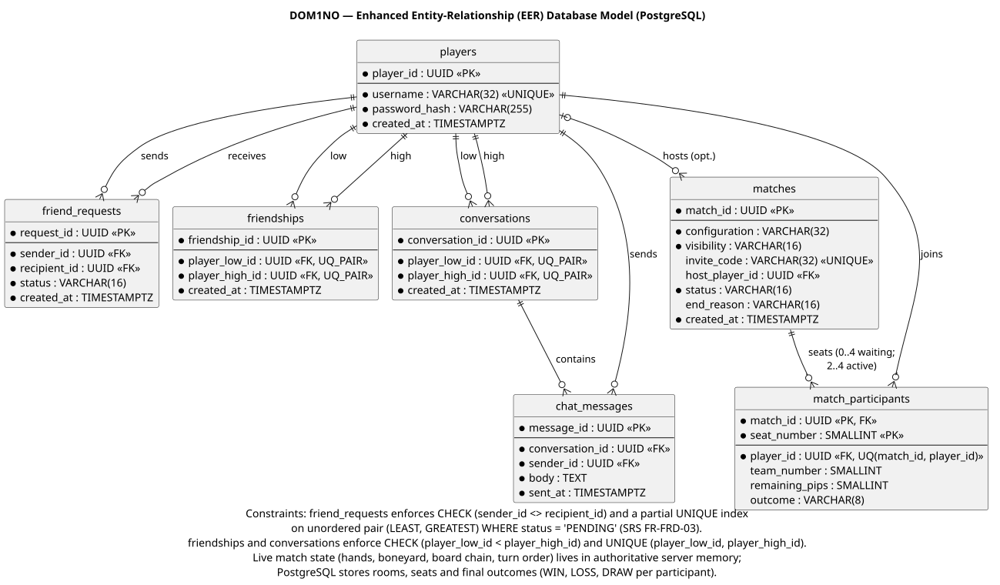

# dom1no — Software Architecture Document (SAD)

**Authors:** Darío, Sahil, Mannoubi

**Status:** Architecture and data design baseline (Week 8, 25 November 2026). This document defines the agreed target architecture; application implementation has not started yet and will follow this baseline.

**Course:** Software Engineering I, DHBW

---

## 1. Introduction

### 1.1 Purpose

This document describes the software architecture of **dom1no** using the Rational Unified Process (RUP) Software Architecture Document template. It translates the requirements in the [Software Requirements Specification](SRS.md) and [Domino Rules](game-rules.md) into architectural layers, UML diagrams, and a PostgreSQL database schema.

### 1.2 Scope

The architecture covers the five semester Use Cases defined in the SRS—playing a match, joining an online match, inviting players to a private match, sending friend requests, and chatting with friends—plus supporting authentication. Class-level design focuses on the two detailed Use Cases ([DUC-01: Play a Domino Match](use-cases/DUC-01-play-domino-match.md) and [DUC-02: Send a Friend Request](use-cases/DUC-02-send-friend-request.md)) while keeping transport and persistence ready for matchmaking, private rooms, and friend chat.

### 1.3 Definitions, Acronyms, and Abbreviations

| Term | Meaning |
| --- | --- |
| **Authoritative Server** | Server that holds the single accepted match state and validates every game action before broadcasting results. |
| **CRUD** | Create, Read, Update, and Delete persistence operations on domain resources. |
| **EER** | Enhanced Entity-Relationship diagram modeling database tables, keys, constraints, and cardinalities. |
| **JPA** | Jakarta Persistence API, used through Spring Data JPA for relational mapping and repository generation. |
| **KMP** | Kotlin Multiplatform, sharing Kotlin code across modules and client targets. |
| **MVC / MVVM** | Model–View–Controller and Model–View–ViewModel architectural patterns for separating presentation, coordination, and domain state. |
| **Protobuf** | Protocol Buffers binary serialization format, used via `kotlinx.serialization-protobuf`. |
| **SAD** | Software Architecture Document (RUP artifact). |

### 1.4 References

- [Software Requirements Specification (SRS)](SRS.md)
- [Domino Rules](game-rules.md)
- [DUC-01 — Play a Domino Match](use-cases/DUC-01-play-domino-match.md) and [Gherkin scenarios](features/DUC-01-play-domino-match.feature)
- [DUC-02 — Send a Friend Request](use-cases/DUC-02-send-friend-request.md) and [Gherkin scenarios](features/DUC-02-send-friend-request.feature)
- [UML Diagrams Index](diagrams/README.md)

### 1.5 Overview

Section 2 explains how MVC principles apply to dom1no's client and server architecture. Section 3 records the chosen frameworks, Gradle module structure, CRUD capabilities, and constraints. Section 4 presents the Overall Use Case Diagram and realizations. Section 5 provides the high-level architecture diagram and class diagram with marked architectural regions. Section 7 presents the UML Deployment Diagram, and Section 9 defines the PostgreSQL EER database model. Sections 6, 8, 10, and 11 are marked N/A per the Week 8 course requirements.

---

## 2. Architectural Representation

### 2.1 MVC and Separation of Concerns

**Model–View–Controller (MVC)** separates an application into three concerns so presentation, coordination, and domain logic can evolve and be tested independently:

- **Model:** Manages domain state, business rules, and persistence independently of the user interface.
- **View:** Renders state and forwards user interactions without owning authoritative data.
- **Controller:** Mediates between user input and the Model, coordinating validation, state updates, and responses back to the View.

### 2.2 Application to dom1no

dom1no is a multiplayer game with an **authoritative server**. The server owns match state and rule validation so no client can forge a move or inspect hidden hands (`SRS FR-ONL-06`, `FR-GAME-04`). dom1no applies MVC across two framework-native patterns:

1. **Client (`:client`) — MVVM (Model–View–ViewModel)** with Compose Multiplatform:
   - **View** (`MatchScreen`, `FriendsScreen`): Declarative Compose screens that observe immutable UI state and emit user events.
   - **ViewModel** (`MatchViewModel`, `FriendsViewModel`): Holds observable `StateFlow` UI state, translates user events into network calls, and exposes confirmed, rejected, or unconfirmed feedback.
   - **Model / Transport** (`MatchSocketClient`, `SocialApiClient`): Sends and receives binary Protocol Buffers payloads defined in `:shared` over WebSockets and HTTP.
2. **Server (`:server`) — Controller–Service–Repository** with Spring Boot:
   - **Controller** (`MatchWebSocketController`, `FriendController`, and auth/room/chat REST controllers): Handles HTTP/WebSocket transport, authenticated identity (`Principal`), and Protobuf serialization.
   - **Service & Authoritative Domain Model** (`MatchService`, `FriendService`, `Match`, `Board`, `Seat`, `Tile`, `MatchRecord`, `Player`, `FriendRequest`, `Friendship`): Implements the MVC **Model**—enforcing all domino rules and social invariants.
   - **Repository** (Spring Data JPA interfaces): Encapsulates PostgreSQL persistence behind typed CRUD interfaces.

| Classic MVC Concern | Client (`:client`, Compose Multiplatform — MVVM) | Server (`:server`, Spring Boot — Controller–Service–Repository) |
| --- | --- | --- |
| **View** | Declarative Compose screens (`MatchScreen`, `FriendsScreen`) | N/A (headless server returning Protobuf payloads) |
| **Controller** | `ViewModel` (`MatchViewModel`, `FriendsViewModel`) | REST & WebSocket Controllers (`FriendController`, `MatchWebSocketController`) |
| **Model** | Client transport & local UI state projections (`MatchSocketClient`, `SocialApiClient`) | Services, authoritative domain model (`Match`, `Board`, `Seat`, `Tile`), and JPA Repositories |

---

## 3. Architectural Goals and Constraints

### 3.1 Chosen Frameworks and Technologies

| Layer / Concern | Technology | Architectural Role |
| --- | --- | --- |
| **Client** | Kotlin Multiplatform + Compose Multiplatform (MVVM) | Shared Kotlin client UI and state management; specific target platforms remain open for now. |
| **Server** | Kotlin + Spring Boot (Controller–Service–Repository) | Dependency injection, HTTP endpoints, WebSocket handling, authentication, and transactions. |
| **Persistence** | Spring Data JPA (Hibernate) + PostgreSQL 16 | Relational storage for accounts, friend requests, friendships, conversations, chat messages, rooms, and match outcomes. |
| **Communication** | HTTP + WebSockets + `kotlinx.serialization-protobuf` | Shared Kotlin `@Serializable` wire models in `:shared` serialized as binary Protocol Buffers; HTTP for request/response resources, WebSockets for real-time match turns. |
| **Build System** | Gradle with Kotlin DSL | Three-module project layout: `:shared` (Protobuf wire models), `:server` (Spring Boot), and `:client` (Compose Multiplatform). |
| **Deployment** | Docker Compose | Reproducible local and hosted container setup running the Spring Boot server and PostgreSQL together. |
| **Testing** | Cucumber JVM + JUnit 5 | Executable Gherkin feature tests and unit tests against the Kotlin domain and server. |

### 3.2 Framework CRUD Capabilities and Authoritative Gameplay Boundary

Spring Boot with **Spring Data JPA** provides convention-over-configuration **CRUD (Create, Read, Update, Delete)** support:

- **Repository generation:** Extending `JpaRepository<Entity, UUID>` (for example, `PlayerRepository`, `FriendRequestRepository`, `FriendshipRepository`, `MatchRepository`) automatically generates runtime implementations for `save()` (Create/Update), `findById()` / `findAll()` (Read), and `deleteById()` (Delete), along with derived queries such as `findByUsernameIgnoreCaseContaining(query: String)`.
- **REST resource mapping:** Spring `@RestController` endpoints expose HTTP verbs (`GET`, `POST`, `PUT`, `DELETE`) backed by these repositories for resource-oriented features:
  - **Accounts & Friends (`DUC-02` and supporting friendship actions):** `GET /api/players?q=...` searches accounts; `GET /api/friends` and `GET /api/friend-requests` list friendships and pending requests; `POST /api/friend-requests` creates a pending request; `PUT /api/friend-requests/{id}/accept` and `PUT /api/friend-requests/{id}/decline` update request status (acceptance creates a friendship); `DELETE /api/friends/{friendId}` removes a friendship for both players.
  - **Private Rooms & Chat:** Creating or joining rooms (`POST`), reading conversation history (`GET`), and storing chat messages (`POST`) follow the same Controller–Service–Repository path.
- **Authoritative gameplay boundary:** Live domino turns (`DUC-01`) do not use generic CRUD `PUT` updates against board state. Clients send typed WebSocket intent commands (`PlaceTile`, `DrawTile`, `PassTurn`). `MatchService` synchronizes access per match (`FR-ONL-09`), validates identity, turn order, and domino rules against authoritative in-memory state, and broadcasts a per-player state update containing only that player's own hand (`FR-GAME-04`, `FR-ONL-07`).

### 3.3 Key Constraints

- **Authoritative validation:** Clients show actions as unconfirmed until the server confirms acceptance or explains rejection (`FR-ONL-10`).
- **Hidden information:** Opponents' unplayed tiles and boneyard order remain strictly on the server (`FR-GAME-04`).
- **UI-independent rules:** Core domino rules (`Match`, `Board`, `Seat`, `Tile`) have no Spring, JPA, or Compose dependencies, enabling deterministic JUnit 5 and Cucumber JVM tests (`NFR-TEST-01`, `NFR-TEST-02`).
- **Planned test migration:** The repository currently contains a small Node.js `cucumber-js` demonstration for one in-memory search scenario; application acceptance tests will be implemented with Cucumber JVM and JUnit 5 alongside the Kotlin codebase.

---

## 4. Use-Case View

The semester scope comprises five Use Cases, with authentication as supporting access. Full functional requirements are maintained in the [SRS](SRS.md).

[Editable PlantUML](diagrams/overall-use-cases.puml)

### 4.1 Use-Case Realizations

The two detailed Use Cases exercise both communication paths of the architecture:

- **[DUC-01 — Play a Domino Match](use-cases/DUC-01-play-domino-match.md)** ([Activity](diagrams/gameplay-activity.svg) · [Sequence](diagrams/gameplay-sequence.svg) · [Scenarios](features/DUC-01-play-domino-match.feature)): Exercises the **WebSocket + Protobuf** path (`MatchScreen` → `MatchViewModel` → `MatchSocketClient` → `MatchWebSocketController` → `MatchService` → `Match`/`Board`/`Seat`/`Tile`), broadcasting per-player updates and persisting outcomes via `MatchRepository`.
- **[DUC-02 — Send a Friend Request](use-cases/DUC-02-send-friend-request.md)** ([Activity](diagrams/friends-activity.svg) · [Sequence](diagrams/friends-sequence.svg) · [Scenarios](features/DUC-02-send-friend-request.feature)): Exercises the **HTTP + Spring Data JPA CRUD** path (`FriendsScreen` → `FriendsViewModel` → `SocialApiClient` → `FriendController` → `FriendService` → `PlayerRepository`, `FriendRequestRepository`, `FriendshipRepository`).

---

## 5. Logical View

### 5.1 Overview

The high-level architectural diagram shows the client MVVM layers (`:client`), shared Protobuf wire contracts (`:shared`), server Controller–Service–Repository layers (`:server`), and PostgreSQL persistence.

[Editable PlantUML](diagrams/architecture-overview.puml)

Two request lifecycles run through this structure:

1. **HTTP / CRUD lifecycle (accounts, friends, rooms, chat):** `View` → `ViewModel` → `SocialApiClient` → HTTP + Protobuf → Spring `@RestController` → `@Service` → `JpaRepository` → PostgreSQL.
2. **WebSocket / authoritative match lifecycle (turns, draw, pass, end-of-match):** `MatchScreen` → `MatchViewModel` → `MatchSocketClient` → WebSocket + Protobuf command → `MatchWebSocketController` → `MatchService` (per-match lock) → Domino Rules Engine (`Match`, `Board`, `Seat`, `Tile`) → per-player `MatchStateMessage` broadcast, with final outcomes persisted via `MatchRepository`.

### 5.2 Architecturally Significant Design Packages

The class diagram follows OMG UML 2.5.1 notation with clearly marked architectural regions for the client MVVM layers and the server Controller–Service–Repository layers.

[Editable PlantUML](diagrams/architecture-class-diagram.puml)

#### Package Responsibilities

| Architectural Region | Key Classes | Responsibilities |
| --- | --- | --- |
| **Client — View (`:client`)** | `MatchScreen`, `FriendsScreen` | Declarative Compose screens displaying board, own hand, active seat, search results, pending states, and textual rejection feedback (`NFR-ACC-01`). |
| **Client — ViewModel (`:client`)** | `MatchViewModel`, `FriendsViewModel` | Hold `StateFlow` UI state, track unconfirmed actions (`FR-ONL-10`), and translate UI intents into transport calls. |
| **Client — Model / Transport (`:client` + `:shared`)** | `MatchSocketClient`, `SocialApiClient` | Manage WebSocket and HTTP connections and serialize `:shared` models with `kotlinx.serialization-protobuf`. |
| **Server — Controller (`:server`)** | `MatchWebSocketController`, `FriendController` | Authenticate requests (`Principal`), bind Protobuf payloads, delegate to services, and return HTTP responses or per-player WebSocket frames. |
| **Server — Service & Authoritative Domain Model (`:server`)** | `MatchService`, `FriendService`, `Match`, `Board`, `Seat`, `Tile`, `MatchRecord`, `Player`, `FriendRequest`, `Friendship` | Enforce domino rules, turn order, per-match locking, private-hand filtering, and friendship invariants. `Match`, `Board`, `Seat`, and `Tile` stay pure Kotlin with no JPA or Spring dependencies; `MatchService` maps match summaries to `MatchRecord`. `Board.place(tile, end)` rotates a legal tile automatically so the matching pip touches the chosen end ([Domino Rules](game-rules.md)). |
| **Server — Repository (`:server`)** | `MatchRepository`, `PlayerRepository`, `FriendRequestRepository`, `FriendshipRepository` | Extend Spring Data's `JpaRepository<T, ID>` to provide CRUD persistence and domain queries against PostgreSQL. |

#### UML Relationship Summary

- **Composition (`*--`):** `Match` owns its `Board` (`1`) and `Seat`s (`2..4`); neither exists outside its match.
- **Association (`-->`):** `Seat`, `FriendRequest` (separate `sender` and `recipient` associations), and `Friendship` reference `Player` without lifetime ownership, so removing a match or friendship never deletes a player account.
- **Generalization (`--|>`) & Dependency (`..>`):** Repository interfaces extend `JpaRepository<T, ID>` via interface generalization; cross-process transport clients depend on server controllers over WebSockets and HTTP.

---

## 6. Process View

**N/A.** Automated deployment processes are deferred to Semester 2 per the Week 8 course guidelines.

---

## 7. Deployment View

The deployment diagram uses UML 2.5.1 notation (`«device»`, `«executionEnvironment»`, `«artifact»`) to show how Compose Multiplatform clients connect to the Docker Compose backend hosting the Spring Boot server and PostgreSQL.

[Editable PlantUML](diagrams/deployment-diagram.puml)

- **Player Device (`1..*`):** Runs the compiled `dom1no-client` artifact on the player's target OS (specific KMP targets remain open).
- **Server Host (`1`):** Runs Docker Compose with two containers on an internal bridge network:
  - **`app-server` container:** Runs `dom1no-server.jar` (Kotlin + Spring Boot). Local development uses plain HTTP/WS; public deployments enforce HTTPS and WSS via TLS termination (`NFR-SEC-05`).
  - **`postgres-db` container:** Runs PostgreSQL 16 with a persistent volume (`dom1no_db`), accessible only to `app-server` over JDBC/TCP.

No public server is deployed yet.

---

## 8. Implementation View

**N/A.** Deferred per the Week 8 course guidelines.

---

## 9. Data View

Because dom1no persists accounts, friendships, conversations, chat messages, rooms, and match outcomes, the Data View is included.

### 9.1 Enhanced Entity-Relationship (EER) Database Model

[Editable PlantUML](diagrams/eer-data-model.puml)

### 9.2 Class-to-Table Mapping and Persistence Boundary

| Table | Primary Key | Key Constraints & Requirement Basis |
| --- | --- | --- |
| `players` | `player_id` (UUID) | `username` `UNIQUE NOT NULL` (`FR-AUTH-03`); `password_hash` stores a salted password hash (`NFR-SEC-01`). |
| `friend_requests` | `request_id` (UUID) | `CHECK (sender_id <> recipient_id)`; partial unique index on `(LEAST(sender_id, recipient_id), GREATEST(sender_id, recipient_id)) WHERE status = 'PENDING'` enforcing one pending request per pair (`FR-FRD-03`). |
| `friendships` | `friendship_id` (UUID) | `CHECK (player_low_id < player_high_id)` and `UNIQUE (player_low_id, player_high_id)` so each friendship is stored once (`FR-FRD-06`–`09`). |
| `conversations` | `conversation_id` (UUID) | `CHECK (player_low_id < player_high_id)` and `UNIQUE (player_low_id, player_high_id)` (`FR-CHAT-01`). Linked to `players` rather than `friendships` so unfriending does not force a cascade delete while chat retention remains open. |
| `chat_messages` | `message_id` (UUID) | Foreign keys to `conversations` and `players` (`sender_id`) storing message text and timestamp (`FR-CHAT-02`–`05`). |
| `matches` | `match_id` (UUID) | Stores `configuration`, `visibility` (`PUBLIC`/`PRIVATE`), optional unique `invite_code`, optional `host_player_id`, `status` (`WAITING`/`ACTIVE`/`FINISHED`), and `end_reason` (`EMPTY_HAND`/`BLOCKED`) (`FR-ONL-01`, `FR-INV-01`–`04`, `FR-GAME-16`). |
| `match_participants` | `(match_id, seat_number)` | `CHECK (seat_number BETWEEN 1 AND 4)`, `UNIQUE (match_id, player_id)`; stores `team_number` (`1` or `2` for 4-player play), `remaining_pips` for blocked games, and per-participant `outcome` (`WIN`, `LOSS`, `DRAW`) so 2-player, 3-player ties, and 4-player team results are all represented uniformly. |

**Persistence and access boundaries:** Live match state (dealt hands, boneyard order, placed tile chain, active seat, and consecutive pass count) stays in authoritative server memory inside `MatchService`; PostgreSQL stores durable accounts, social state, rooms, and match results. Service-layer checks enforce data visibility independently of database foreign keys: `password_hash` is never sent to clients, each player receives only their own hand (`FR-GAME-04`), and conversations are readable only by their two participants (`FR-CHAT-06`). Product decisions such as persistent match recovery, invitation expiration, and chat retention remain open in [SRS §7](SRS.md#7-open-decisions).

---

## 10. Size and Performance

**N/A.** Proposed, unmeasured timing targets (`NFR-PER-01`, `NFR-PER-02`) are recorded in [SRS §5](SRS.md#5-quality-requirements); formal sizing and benchmarks are deferred until implementation exists.

---

## 11. Quality

**N/A.** Quality requirements (`NFR-SEC-01`, `NFR-SEC-02`, `NFR-SEC-05`, `NFR-ACC-01`, `NFR-TEST-01`, `NFR-TEST-02`) are maintained in [SRS §5](SRS.md#5-quality-requirements) and supported directly by password hashing, server-side authorization checks, TLS termination on public hosts, textual UI feedback, and the UI-independent Kotlin rules engine.
