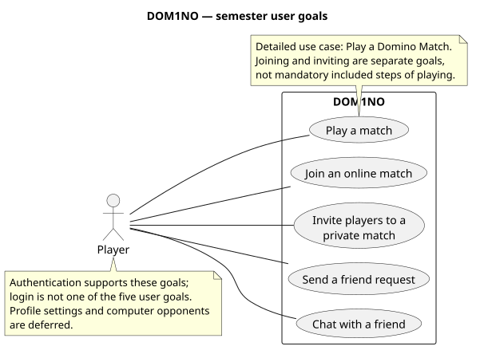

# dom1no — Software Requirements Specification

**Authors:** Darío, Sahil, Mannoubi

**Status:** Working specification; scope and game rules agreed on 9 November 2026. The application is not implemented.

**Course:** Software Engineering I, DHBW

## 1. Purpose and scope

dom1no lets people play a complete online domino game together. Players choose two-player individual, three-player individual, or four-player partnership play. They can find opponents publicly or enter a private room. Friend requests and friend chat support playing with people they know.

The semester scope contains **five user goals, excluding login**:

| Goal | Boundary | Current detail |
| --- | --- | --- |
| Play a match | Take turns, place/draw/pass, and see the result of an already-created match. | [Detailed use case and activity](use-cases/DUC-01-play-domino-match.md) · [Scenarios](features/DUC-01-play-domino-match.feature) |
| Join an online match | Choose a configuration and wait for the required opponents. | Requirements below; detailed case is later work. |
| Invite players to a private match | Create a configured room and let invited players join it. | Requirements below; invitation mechanism remains open. |
| Send a friend request | Find a player, submit a request and make it available to the recipient. | [Detailed use case and activity](use-cases/DUC-02-send-friend-request.md) · [Scenarios](features/DUC-02-send-friend-request.feature) |
| Chat with a friend | Open a private conversation and exchange text. | Requirements below; delivery and retention choices remain open. |

Login is supporting access, not one of the five goals. Accepting a request and displaying/removing an existing friendship are supporting friendship behavior; they are not steps in sending a request. Computer opponents, profile editing, statistics and extensive settings are deferred rather than promised as additional semester goals. There are no paid features, tournaments or leaderboards in this scope.

[Editable PlantUML](diagrams/overall-use-cases.puml)

### How to use this specification

Read the [game rules](game-rules.md) for the exact behavior, then the two detailed use cases for interactions and failure paths. Requirements below retain existing IDs so references remain meaningful; removed IDs are not reassigned. Section 7 separates unanswered choices from agreed behavior.

## 2. Players and system boundary

A **player** is a person using dom1no. Account-related actions require a signed-in player. A **match** is one game, not a sequence of scored rounds. A **hand** contains one player's unplayed tiles. The **boneyard** contains the undealt tiles in individual play. In partnership play, opposite seats form a team.

The system includes the player interface and the service that decides whether actions are accepted. This accepted state is the **authoritative match state**: clients cannot independently decide that a move succeeded. The hosting architecture and client framework are not yet chosen.

Online functions need a network connection. If an action has no confirmed response, the interface must not claim success. A lost response is not proof that the service rejected the action; reconnecting and recovering the result remain open decisions.

## 3. Functional requirements

“Shall” describes intended product behavior, not completed implementation. An example: with open ends 3 and 1, `3|5` can be placed at the 3 end and exposes 5; `6|6` must be rejected without changing the board, hand or turn. The [rules](game-rules.md) also explain opening tiles, drawing, passes and team outcomes.

### 3.1 Play a match

| ID | Requirement |
| --- | --- |
| FR-GAME-03 | The system shall shuffle, deal and establish the opening turn according to the selected configuration and the game rules. |
| FR-GAME-04 | The system shall show the acting player's hand without revealing other players' unplayed tiles. |
| FR-GAME-05 | The system shall display the accepted board and its two open ends. |
| FR-GAME-06 | The system shall identify the active player and, in partnership play, the two teams. |
| FR-GAME-07 | The system shall let the active player select a tile and an end at which to place it. |
| FR-GAME-08 | The system shall accept a placement only if the tile is in the acting player's hand and matches the chosen open end under the game rules. |
| FR-GAME-09 | Rejecting a placement shall leave the board, every hand, the active turn and the pass count unchanged. The acting player shall see why the placement was rejected. |
| FR-GAME-10 | An accepted placement shall remove that tile from the player's hand, extend the board and reset consecutive passes. |
| FR-GAME-11 | After an accepted placement or pass that does not end the match, the system shall advance the turn in seat order. Drawing retains the active player's turn for placement or pass. |
| FR-GAME-14 | When no placement is possible, the system shall apply the selected variant's draw/pass rule. It shall not allow drawing or passing instead of an available placement. |
| FR-GAME-15 | The system shall end a match immediately when a hand becomes empty or every participant has passed consecutively. |
| FR-GAME-16 | The system shall show the winning player/team or draw, the end reason, and remaining pip totals when those totals determine a blocked result. |

### 3.2 Join an online match

| ID | Requirement |
| --- | --- |
| FR-ONL-01 | The system shall let players choose two-player individual draw, three-player individual draw or four-player partnership block before entering matchmaking. |
| FR-ONL-02 | The system shall keep a player waiting until enough players are available for the chosen configuration. It shall not change that configuration automatically. |
| FR-ONL-03 | The system shall identify matches separately so an action cannot affect a different match. |
| FR-ONL-04 | The system shall accept match actions only from participants in that match. |
| FR-ONL-05 | The system shall reject a placement, draw or pass from a participant whose turn is not active. |
| FR-ONL-06 | The service shall validate each submitted action against the current authoritative state, not merely trust the client's claim. |
| FR-ONL-07 | After an accepted action, the system shall make the resulting board, active turn, hand counts and match status available to all participants; each participant receives only their own hand. |
| FR-ONL-08 | The system shall return rejection feedback to the sender of a rejected action. |
| FR-ONL-09 | The system shall prevent conflicting actions from both being accepted as transitions from the same state. |
| FR-ONL-10 | Without a confirmed outcome, the interface shall show the action as unconfirmed, not as a successful move or a proven rejection. |

### 3.3 Private matches

| ID | Requirement |
| --- | --- |
| FR-INV-01 | The system shall let a host create a private room with one of the three configurations and show it to joiners. |
| FR-INV-02 | The system shall provide an invitation identifying the host's private room. The sharing mechanism is still to be chosen. |
| FR-INV-03 | The system shall let the host obtain the invitation for sharing. |
| FR-INV-04 | A valid invitation shall identify the associated room. |
| FR-INV-05 | The system shall permit eligible invitees to occupy available seats and permit the host to start only when the selected number of seats is full. Eligibility rules remain open. |
| FR-INV-06 | The system shall reject invitations that do not identify an available room. |
| FR-INV-07 | The system shall tell the joining player why entry was rejected. |

### 3.4 Friend requests and supporting friendship behavior

| ID | Requirement |
| --- | --- |
| FR-FRD-01 | Username search shall return usernames containing the entered text, ignoring case, and exclude the sender's own account. |
| FR-FRD-02 | The system shall display the signed-in player's existing friends. |
| FR-FRD-03 | The system shall let a signed-in player send a request to another account. It shall reject requests to self and existing friends and permit only one pending request per account pair. If an incoming request already exists, show it with Accept/Decline instead of creating a reciprocal request. |
| FR-FRD-04 | The system shall record a pending request for the intended recipient, make it visible to that recipient and confirm a successful submission to the sender. |
| FR-FRD-05 | The system shall let the recipient accept a pending request. |
| FR-FRD-06 | Acceptance shall create a friendship; sending alone shall not. |
| FR-FRD-07 | Accepted friends shall appear in both participants' lists. |
| FR-FRD-08 | The system shall let a signed-in player remove an existing friend. |
| FR-FRD-09 | Removing a friendship shall remove it from both participants' lists. |

No search result shall allow the sender to infer a request was sent. Cancelling before submission sends nothing. A failed or unconfirmed submission must not produce a success message. The lifecycle after decline, cancelling a submitted request, blocks and privacy rules need agreement before their detailed behavior is specified.

### 3.5 Friend chat and account access

| ID | Requirement |
| --- | --- |
| FR-CHAT-01 | The system shall let a signed-in player open a conversation with a friend. |
| FR-CHAT-02 | The system shall allow text submission to that friend. |
| FR-CHAT-03 | Each accepted message shall identify its sender and conversation. |
| FR-CHAT-04 | The system shall make accepted messages available to their intended recipient. Live delivery versus refresh is undecided. |
| FR-CHAT-05 | Opening a conversation shall show the history that the agreed retention policy makes available. Retention and unfriending behavior are undecided. |
| FR-CHAT-06 | The system shall prevent nonparticipants from reading a private conversation. |
| FR-AUTH-03 | Account usernames shall be unique. |
| FR-AUTH-05 | The system shall provide account login. Login identifiers, credential validation, registration and recovery policy still need specification. |
| FR-AUTH-06 | Invalid credentials shall not grant an authenticated session. |
| FR-AUTH-07 | The system shall let a signed-in player log out. |
| FR-AUTH-08 | Logging out shall end that session's access to authenticated actions. |

## 4. Data and interfaces

The service needs accounts, match configuration and seats, hands, board, turn and pass count, request/friendship state, and private messages. It must distinguish a pending request from an accepted friendship. These are logical data needs, not a database schema.

The interface must distinguish waiting, active and finished matches. It must show which player can act, explain rejection in text rather than color alone, and distinguish unconfirmed delivery from a rejected action. The [gameplay](mockups/gameplay.svg) and [friends](mockups/friends.svg) wireframes illustrate these states; they are designs, not application screenshots.

Every match action must identify its match and actor. Responses must distinguish acceptance from rejection and identify the resulting accepted state so stale actions cannot overwrite newer ones. Social actions identify their applicable account, request or conversation rather than an unrelated match. Protocols, storage products and hosting are implementation choices, not requirements imposed here.

## 5. Quality requirements

| ID | Requirement or proposed target | How to check it |
| --- | --- | --- |
| NFR-SEC-01 | Store password verification data using a password-storage hash, not plaintext or reversible encryption. | Inspect authentication code and storage when implemented. |
| NFR-SEC-02 | A player must not modify another account without authorization. | Unauthorized-request checks. |
| NFR-SEC-05 | Encrypt credentials and private messages in transit over public networks. | Inspect deployment configuration. |
| NFR-ACC-01 | Turn ownership and rejection must not rely on color alone. | Inspect wireframes, then the implemented interface. |
| NFR-TEST-01 | Game rules must be testable without manually operating the UI. | Exercise legal/illegal placements, draws, passes and both end conditions with fixed game states. |
| NFR-TEST-02 | Rules tests must support reproducible starting states. | Initialize a known board, hands, stock and active player. |
| NFR-PER-01 | Proposed target: at least 95 of 100 accepted online placements reach every other connected participant's display within two seconds of acceptance. | Approve the network/device environment before measurement. |
| NFR-PER-02 | Proposed target: at least 95 of 100 local board inputs receive visible feedback within 500 ms. | Choose a reference device before measurement. |

The timing targets have not been measured or approved as release criteria. State consistency and rejection guarantees are specified once in Section 3 rather than repeated as separate quality requirements.

## 6. Verification and academic evidence

The two [feature files](features/README.md) narrate expected outcomes for the detailed use cases. Their activity diagrams and wireframes show the same user goals. Most scenarios are not automated; a small in-memory search demonstration shows editor/framework integration, not application correctness. Implementing and executing application scenarios is later course work.

For example, an illegal `6|6` placement against open ends 3 and 1 must produce feedback while preserving the hand, board and turn. A blocked comparison must distinguish pip totals from tile counts: `6|6` loses to `0|0` plus `1|1` in individual play. These examples give a reviewer an expected answer before any implementation exists.

Sources for the academic structure are the course's Week 3 SRS, Week 4 Use Cases and Week 5 Feature File tasks. The exact SRS/Use Case templates and current whiteboard still need checking; this document does not claim verified template conformity. ISO/IEC/IEEE 29148:2018 and the [NASA requirement-writing guidance](https://www.nasa.gov/reference/appendix-c-how-to-write-a-good-requirement/) inform requirement wording, not a claim of standards certification.

## 7. Open decisions

These recommendations need a team answer before they become requirements. They do not change the agreed game rules, search matching or one-pending-request-per-pair policy.

| Decision | Alternatives and recommendation | Work affected |
| --- | --- | --- |
| Client platform | Browser first or Compose Multiplatform. Recommend a browser so classmates can join without installation. No stack is selected. | Application setup and device-specific performance checks. |
| Disconnects and unconfirmed actions | Pause and allow rejoin, or terminate without a result. Recommend pause/rejoin; agree a deadline and how clients recover an unconfirmed outcome before adding forfeits or automatic retries. | Recovery behavior and acceptance scenarios. |
| Empty searches and request lifecycle | Empty queries can show no results or ask for a username; recommend the prompt. Declining can permit a new request immediately or impose a cooldown; recommend a new explicit request initially. Visibility, blocking and withdrawal of submitted requests still need policies. | Search edge cases, request retry and privacy. |
| Private invitations | Shareable room link or direct invitation to an existing friend. Recommend a room link available to the host; agree eligibility and link lifetime. | Detailed invitation flow. |
| Friend chat | Retained or session-only history; live delivery or refresh. Recommend retained history and live delivery, with explicit retention and unfriending behavior. | Detailed chat flow and data lifecycle. |

Queue cancellation and waiting-time limits, registration, credential validation, account recovery and public-release policy also remain unspecified. No production-readiness or privacy-compliance claim is made.

For substantive changes, explain the reason in the Git commit or pull request and update affected diagrams and scenarios together.
