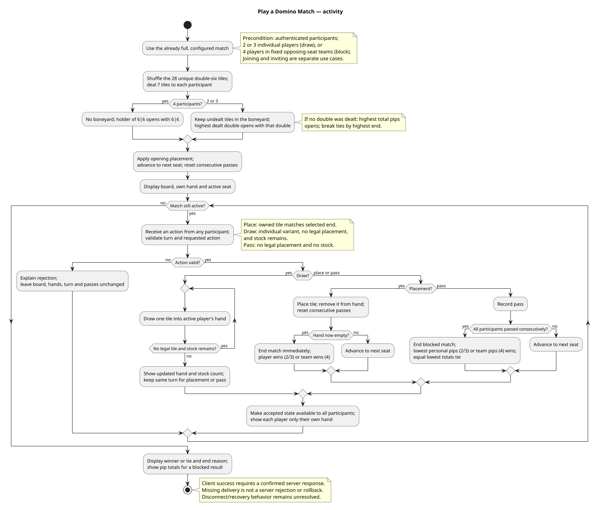
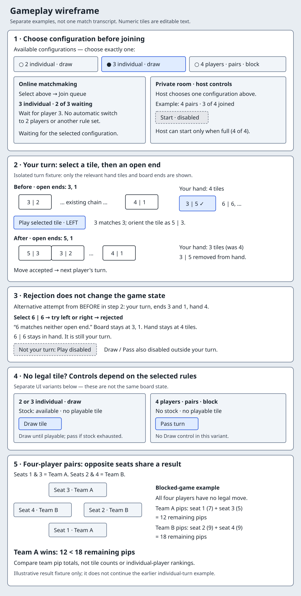

# DUC-01 — Play a Domino Match

**Primary actor:** Signed-in player; **other actors:** the other match participants.

**Related requirements:** [SRS](../SRS.md), `FR-GAME-03`–`FR-GAME-11`, `FR-GAME-14`–`FR-GAME-16` and `FR-ONL-03`–`FR-ONL-10`.

**Narration:** [Gherkin scenarios](../features/DUC-01-play-domino-match.feature). These describe intended behavior, not implemented application tests.

## Goal and boundary

The player completes one online domino game and sees its result. Matchmaking and private-room setup happen before this goal starts. There is no computer opponent or multi-round score in the current scope.

## Preconditions and trigger

- The player is an authorized participant in a full, configured match.
- The chosen configuration is two individual players, three individual players, or four players in fixed opposite-seat partnerships. Public matchmaking waits for exactly the chosen configuration with no automatic fallback; a private host starts only when the chosen configuration is full.

**Trigger:** The configured match starts. Joining the match and filling its seats are separate goals; shuffling, dealing and opening belong to playing it.

## Main success scenario

1. The system shuffles and deals seven tiles each, identifies the opener and applies the opening placement under the [game rules](../game-rules.md). The next seat becomes active.
2. The system shows the board, the player's hand and whose turn it is.
3. On their turn, the player chooses a tile, an open end and its orientation. For example, with an open end of 6, `6|3` can be placed with its 6 touching that end.
4. The system checks participant identity, turn and placement against the authoritative match state.
5. The system accepts the legal placement, adds the tile to the board and removes it from the player's hand. A placement resets the consecutive-pass count.
6. If the hand is empty, the system immediately ends the game and shows that player's victory, or their partnership's victory in four-player play.
7. Otherwise, the system advances to the next seat and makes the accepted state available to all participants.
8. Participants repeat their turns until a hand is empty or consecutive passes end a blocked game. The system displays the result, including a tie where applicable.

## Alternatives and failures

| Situation | Behavior |
| --- | --- |
| A placement does not match the selected open end, or has the wrong orientation | Explain the rejection; leave board, hand and active turn unchanged; allow another choice. |
| A participant submits a placement out of turn | Reject it without changing the authoritative match state. |
| No tile in hand can be placed, and the boneyard contains tiles | In two-/three-player play, draw until a legal tile is obtained or the boneyard is empty. A legal drawn tile can be placed on this turn; drawing alone does not advance the turn. |
| No tile can be placed and there is no stock | Pass and advance to the next seat. This also applies to four-player play, where there is never a boneyard. |
| Consecutive passes reach the number of players | End the blocked game. In individual play, the lowest remaining hand pip total wins; equal lowest totals tie. In partnerships, compare the two teams' combined remaining pip totals; the lower total wins, or equal totals tie. |
| Another participant empties their hand | End immediately and show their individual or partnership victory; do not offer another turn. |
| A move is known not to have been sent | Do not show it as accepted. |
| A response is lost after a move was sent | Acceptance is unknown: do not claim rejection, success or unchanged authoritative state without confirmation. |

## Outcome and remaining questions

**Success:** The finished game's winner or tie is displayed. **Rejection guarantee:** A rejected placement changes neither board, hand nor turn. A communication failure is not necessarily a rejected placement.

The [game rules](../game-rules.md) are the authority for dealing, placement and outcomes. Disconnect recovery, reconnect timing and abandoned-match outcomes still need decisions; this use case does not invent them.

## Activity diagram

[Editable PlantUML](../diagrams/gameplay-activity.puml) · [Supporting sequence diagram](../diagrams/gameplay-sequence.svg)

## Interface wireframe

The panels illustrate turn display, tile selection, rejected placement, waiting and the game result. Edit the SVG itself; this is a design, not an application screenshot.
