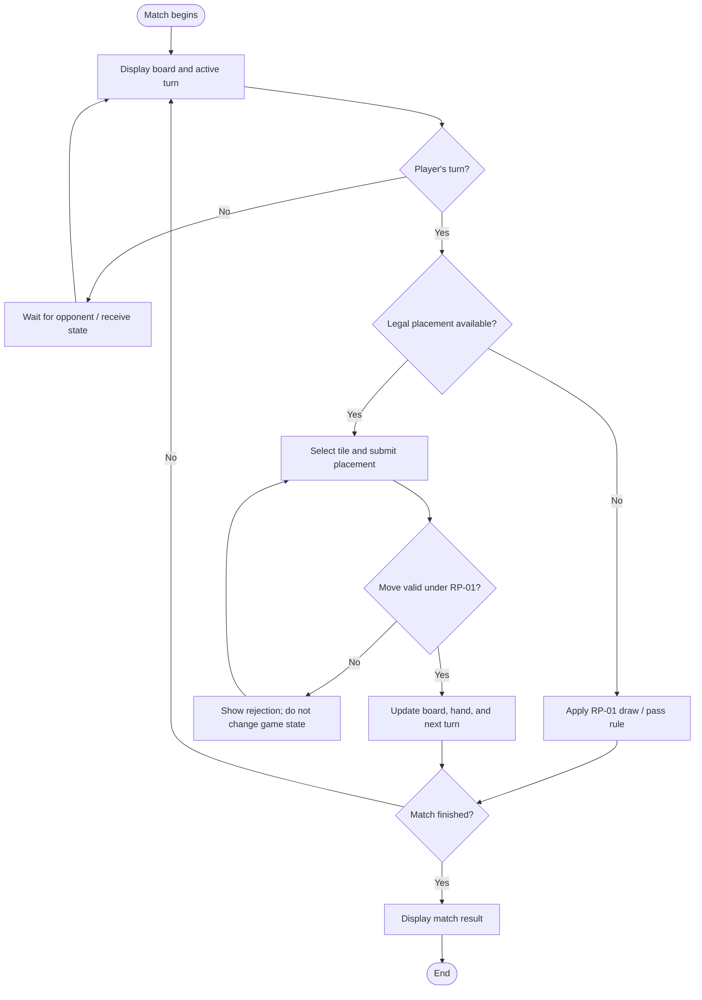
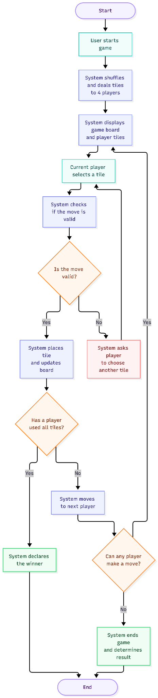
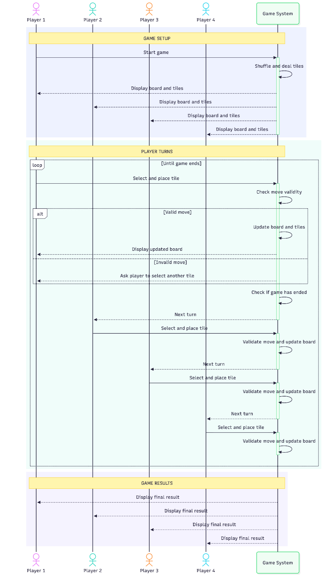
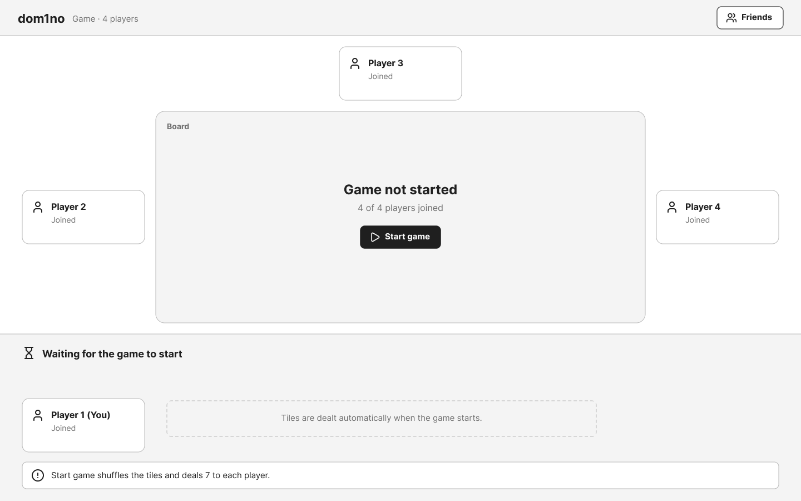
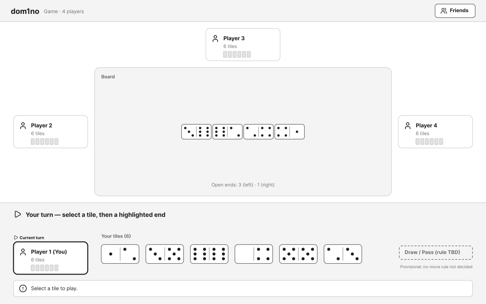
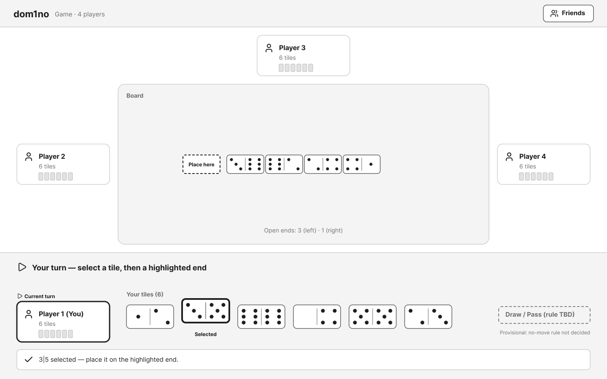
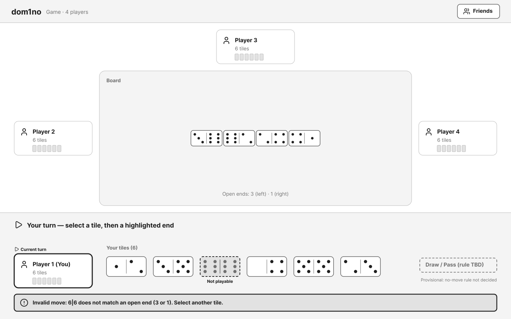
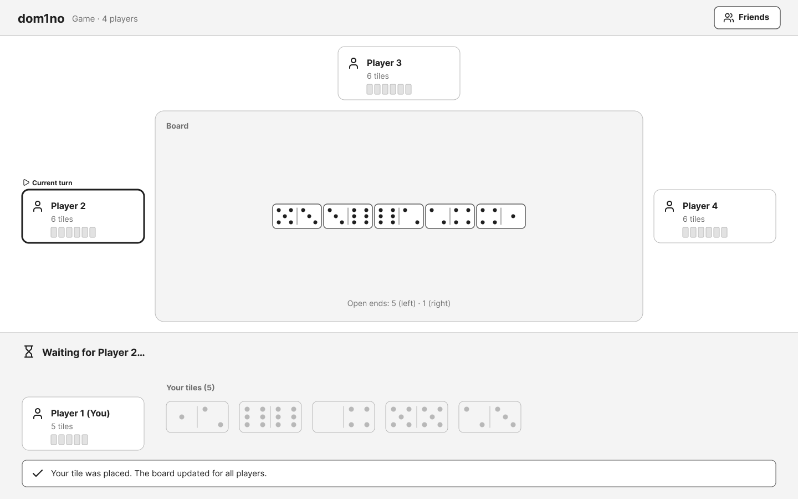
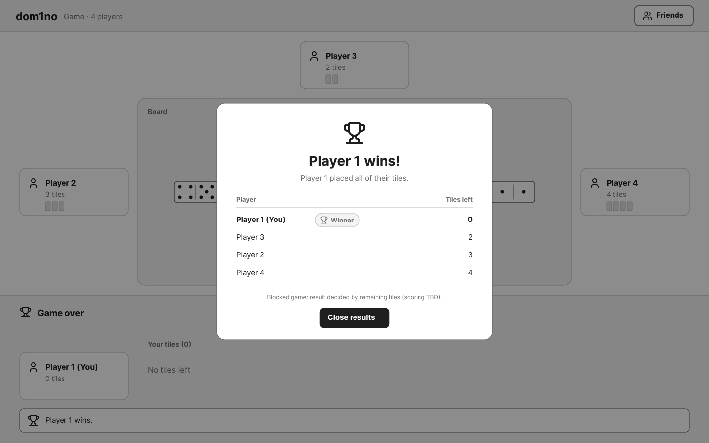

# DUC-01 — Play a Domino Match

**Project:** dom1no  
**Status:** Draft for team review  
**Primary actor:** Player  
**Scope:** dom1no game system  
**Level:** User goal  
**Related SRS:** [dom1no_SRS_v0.2.md](../../dom1no_SRS_v0.2.md), especially `FR-GAME-03`–`FR-GAME-16`; for online matches also `FR-ONL-03`–`FR-ONL-10`.  
**Design references:** [Figma prototype](https://www.figma.com/design/kJDrWOX1E7Uci3U2Gp9Cvs/Untitled?node-id=0-1&t=MYacNVOjFRvgLBVh-1)

## 1. Brief description

A player completes a domino match by taking turns, placing valid tiles, and seeing the match result. The same core gameplay applies whether the opponent is a computer or another player. Starting the match and choosing an opponent are treated as supporting interactions; this use case focuses on **playing a match**.

## 2. Preconditions

- A match has been created, with the players and initial game state established according to the approved Rules Profile `RP-01`.
- The player has access to the match; for an online match, they are an authorized participant.

## 3. Trigger

The match begins and the game board is presented.

## 4. Main success scenario

1. The system displays the board, the player's tiles, and the active turn.
2. On the player's turn, the player selects a tile and submits a placement.
3. The system validates the proposed placement against the current match state and `RP-01`.
4. The system accepts a legal move and updates the board and the player's hand.
5. The system makes the updated state available to the participants and advances the turn according to `RP-01`.
6. The opponent completes their turn according to the match mode and game rules.
7. Steps 1–6 repeat until the configured end condition is reached.
8. The system determines and displays the match result according to `RP-01`.

## 5. Extensions and alternative flows

| Step | Condition | System behavior |
| --- | --- | --- |
| 2–3 | Player submits an invalid placement | Reject the action, explain it was not accepted, leave the authoritative match state unchanged, and allow another choice (`FR-GAME-09`, `FR-ONL-08`). |
| 2 | It is not the player's turn | Do not accept a placement (`FR-ONL-05` for online play). |
| 2 | No legal placement is available | Apply the draw/pass/blocked-game rule specified by `RP-01` (`FR-GAME-14`). |
| 3–5 | Online request cannot be delivered | Do not show it as an accepted move; recovery behavior remains to be decided (`FR-ONL-10`, `DEC-06`). |
| 6 | Computer is the active opponent | Computer chooses and applies a rule-compliant move (`FR-GAME-12`, `FR-GAME-13`). |
| 7–8 | Match ends in a tie or blocked state | Determine outcome using `RP-01`, once approved. |

## 6. Postconditions

**Success:** The match is finished and its result is displayed.  
**Minimal guarantee:** Any rejected move has not changed the authoritative game state.

## 7. Rules, open decisions and constraints

- `RP-01` still needs the chosen domino variant, deal, valid placements, draw/pass rules, round termination, tie handling, and scoring; this document does **not** assert those rules are already finalized.
- Match disconnect/rejoin and abandonment handling (`DEC-06`) remain open.
- UI screenshots are **proposed designs**, not confirmation of implemented behavior.

## 8. Activity diagram (goal-specific draft)

## 9. Supporting diagrams and mockups

Existing team activity and sequence diagrams (broader gameplay overview):

Proposed interface screens, in order:

For the editable UI design, see [Figma](https://www.figma.com/design/kJDrWOX1E7Uci3U2Gp9Cvs/Untitled?node-id=0-1&t=MYacNVOjFRvgLBVh-1).

## 10. Acceptance checks to define

- A legal placement updates the authoritative board and the active player's hand.
- An illegal placement leaves the authoritative game state unchanged.
- A player cannot play out of turn in an online game.
- The result appears when the approved `RP-01` end condition is met.

> **Review note:** This detailed use-case ID is `DUC-01` to avoid confusion with the SRS appendix's `UC-01`, which identifies the broader **Gameplay Use Cases diagram**.
