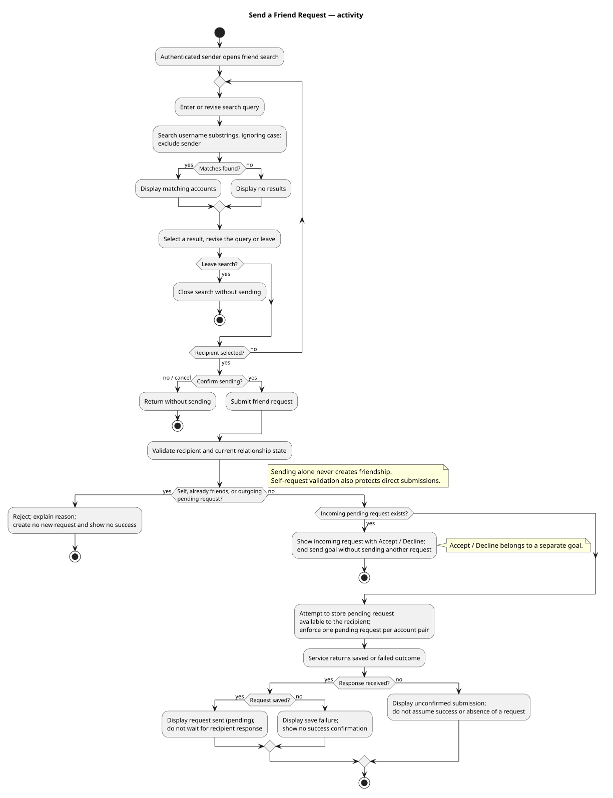
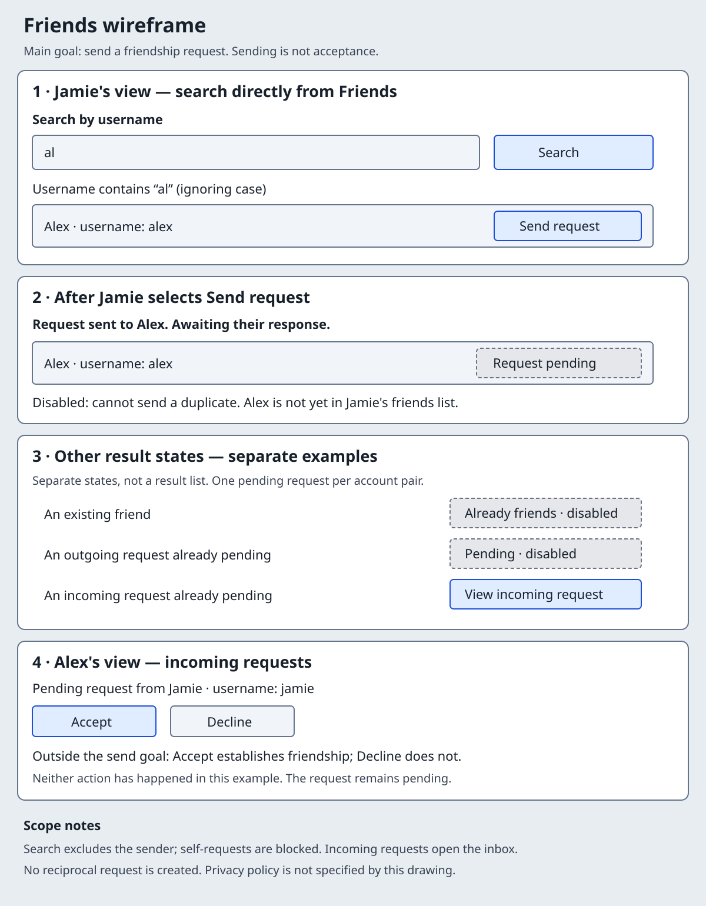

# DUC-02 — Send a Friend Request

**Primary actor:** Signed-in player (sender); **supporting actor:** intended recipient.

**Related requirements:** [SRS](../SRS.md), `FR-FRD-01`, `FR-FRD-03` and `FR-FRD-04`. Accepting a request and displaying the resulting friendship are supporting goals under `FR-FRD-05`–`FR-FRD-07`; removing a friend is covered by `FR-FRD-08`–`FR-FRD-09`.

**Narration:** [Gherkin scenarios](../features/DUC-02-send-friend-request.feature).

## Goal and boundary

The player finds another account and sends a pending friend request. Sending does not itself create a friendship. Acceptance, decline, removal, chat and game invitations are outside this detailed goal.

## Preconditions and trigger

The sender is signed in. **Trigger:** They open Friends to find another player. Username search is available directly in this screen; an extra **Add Friend** action is not required before searching.

## Main success scenario

1. The sender enters all or part of a username in the Friends search field, for example `pLaYeR2` to find `PLAYER2`.
2. The system matches usernames by case-insensitive substring, excludes the sender's own account and displays matching accounts the sender is allowed to discover, including identifying information.
3. The sender selects `PLAYER2` and chooses to send a friend request.
4. The system checks that sender and recipient differ, are not already friends and do not already have a pending request in either direction. It also checks any applicable eligibility policy.
5. The system records one pending request and makes it available to `PLAYER2`.
6. After confirmed submission, the system tells the sender that the request was sent. Neither account is added to the other's friends list at this point.

## Alternatives and failures

| Situation | Behavior |
| --- | --- |
| Search has no matches | Show an empty-result message and allow a revised query. |
| Sender cancels before submission | Leave without creating a request. |
| Sender targets their own account | Reject the self-request. |
| Accounts are already friends | Explain that they are already friends; create no request. |
| The same sender already has a pending request to that recipient | Explain that a request is already pending; do not create a duplicate. |
| A pending request from the intended recipient to the sender already exists | Show the existing incoming request with Accept/Decline choices instead of creating another request. Choosing either action belongs to the supporting request-management goal. |
| Submission cannot be confirmed because of a storage/network failure | Show a failure or unconfirmed status, not a successful-send confirmation. Do not assert that no request exists if a write may already have happened. |

## Outcome and remaining questions

**Success:** One pending request exists for the intended recipient and is available to them. **Guarantees:** A request alone does not create a friendship; a disallowed self/duplicate request does not create another request; an unconfirmed submission is not shown as successfully sent.

Result ranking, empty-query behavior, discoverability/privacy and blocked-account policy remain unresolved. Cancellation here means leaving **before submission**, not withdrawing an already pending request. The decline lifecycle and retry/reconciliation after uncertain submission still need decisions. No notification channel or timing is promised beyond making the request available to its recipient.

## Activity diagram

[Editable PlantUML](../diagrams/friends-activity.puml) · [Supporting sequence diagram](../diagrams/friends-sequence.svg)

## Interface wireframe

The screen shows direct search, pending feedback, disabled duplicate actions and the recipient's separate inbox. The activity and scenarios specify failure feedback. Edit the SVG itself; this is a design, not an application screenshot.
