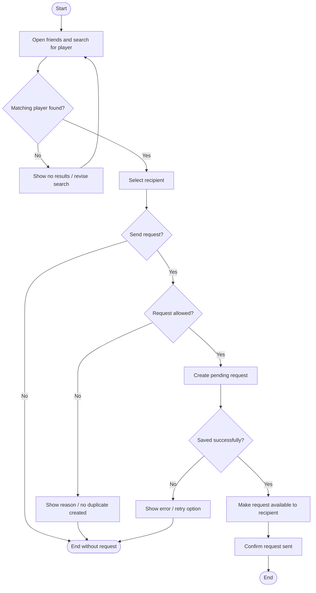
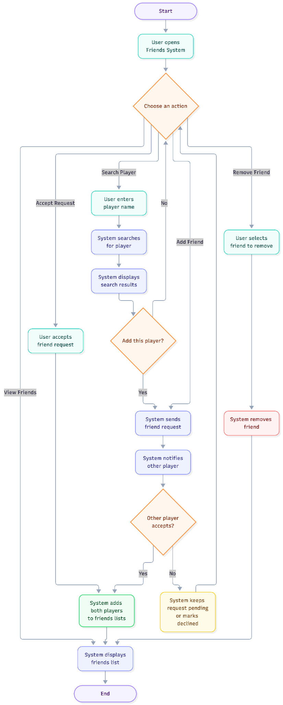
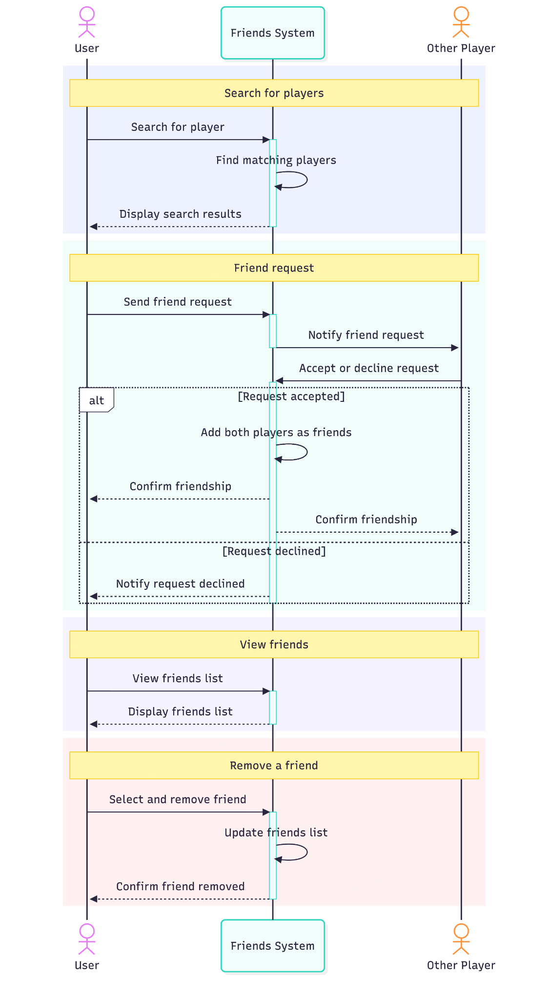
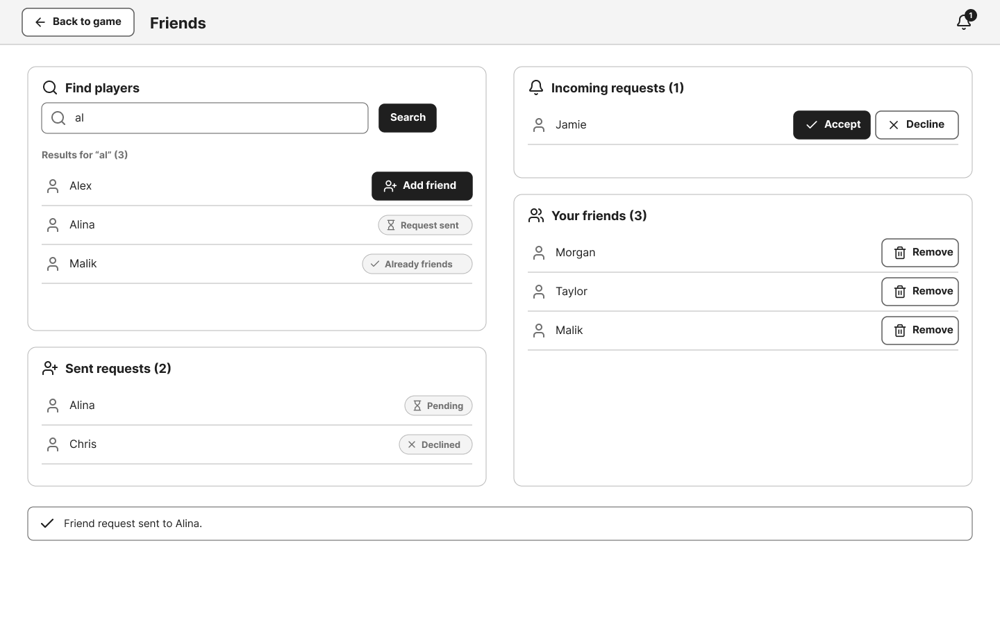
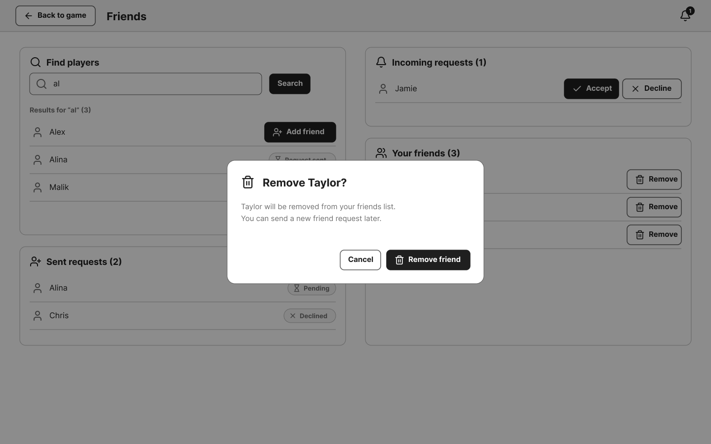

# DUC-02 — Send a Friend Request

**Project:** dom1no  
**Status:** Draft for team review  
**Primary actor:** Authenticated player (sender)  
**Supporting actor:** Target player (recipient)  
**Scope:** dom1no social system  
**Level:** User goal  
**Related SRS:** [dom1no_SRS_v0.2.md](../../dom1no_SRS_v0.2.md), `FR-FRD-01`, `FR-FRD-03`, `FR-FRD-04`; later acceptance belongs to `FR-FRD-05`–`FR-FRD-07`.  
**Design references:** [Figma prototype](https://www.figma.com/design/kJDrWOX1E7Uci3U2Gp9Cvs/Untitled?node-id=0-1&t=MYacNVOjFRvgLBVh-1)

## 1. Brief description

An authenticated player finds another player and sends them a friend request. A friendship does **not** exist just because the request was sent; accepting it is a separate user goal.

## 2. Preconditions

- The sender is signed in.
- The social/player search feature is available.
- The target account can be identified using the search method to be agreed by the team (`DEC-09`).

## 3. Trigger

The sender chooses to add another player as a friend.

## 4. Main success scenario

1. The player opens the friends area and searches for another player.
2. The system presents matching players that the sender is permitted to find.
3. The player selects the intended recipient and chooses **Send friend request**.
4. The system checks that the sender can request friendship with this account.
5. The system records a pending friend request and makes it available to the recipient.
6. The system confirms to the sender that the request has been submitted.

## 5. Extensions and alternative flows

| Step | Condition | System behavior / status |
| --- | --- | --- |
| 2 | No player matches | Show no results and allow another search. |
| 3 | Player cancels before sending | End without creating a request. |
| 4 | Recipient is the sender | Reject the request; self-request behavior should be explicitly agreed (`DEC-09`). |
| 4 | Friendship or pending request already exists | Do not create a duplicate; response and reciprocal-request handling remain to be specified (`DEC-09`). |
| 4 | Recipient is not eligible / is hidden or blocked | Reject according to the yet-to-be-agreed privacy and eligibility rules (`DEC-09`). |
| 5 | Network or storage operation fails | Do not confirm successful delivery; show an error and offer a retry. |

## 6. Postconditions

**Success:** A pending request exists for the intended recipient and is visible to that recipient according to the application's request presentation mechanism.  
**Minimal guarantee:** No friendship is created merely by submitting the request; unsuccessful attempts are not presented as completed requests.

## 7. Boundary and open decisions

- **In scope:** find/select a target, submit request, make request available, show feedback.
- **Out of scope:** accept/decline, remove friend, chat, and managing a friend's game invitation. These are separate user goals.
- `DEC-09` remains open for search identifiers, duplicate requests, reciprocal requests, blocked accounts, privacy and cancellation.
- UI screenshots are proposals, not evidence of implementation.

## 8. Activity diagram (goal-specific draft)

## 9. Supporting diagrams and mockups

Existing broader team diagrams (also cover accepting/removing friends):

Editable mockups: [Figma](https://www.figma.com/design/kJDrWOX1E7Uci3U2Gp9Cvs/Untitled?node-id=0-1&t=MYacNVOjFRvgLBVh-1).

## 10. Acceptance checks to define

- Sending an eligible request records one pending request for the correct recipient.
- The recipient can view the received request.
- Cancelling before submission does not create a request.
- A failed or disallowed request is not reported as successfully sent.

> **Review note:** `DUC-02` refers to this detailed use case; `UC-02` in the SRS appendix names the **Authentication Use Case diagram**.
